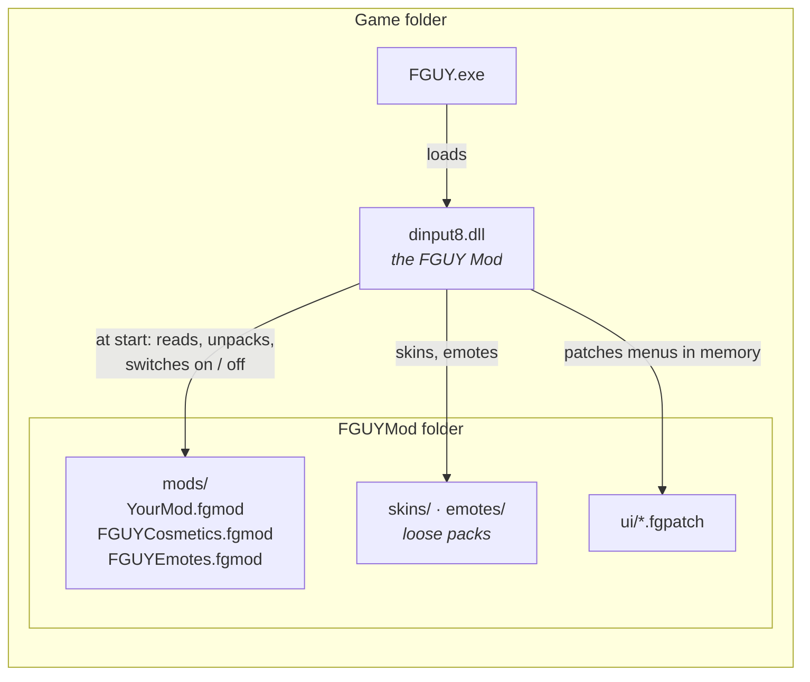

# FGUY Mod — Modding Guide

**Make your own skins, outfits, emotes, menu changes and gameplay mods for
*Family Guy: Back to the Multiverse* (PC).**

[Getting started](getting-started.md) ·
[Mod structure](mod-structure.md) ·
[Skins](skins.md) ·
[Outfits & models](models.md) ·
[Emotes](emotes.md) ·
[Menu & HUD patches](ui-patches.md) ·
[Plugins](plugins.md) ·
[Online play](online.md) ·
[Testing](testing.md) ·
[Sharing](sharing.md)

---

## What you can make

| Kind | What it changes | Made with | Needs code? |
|---|---|---|:---:|
| 🎨 **Skin** | A character's colours and painted details | The [Skin Studio](skins.md#the-skin-studio) | No |
| 🤠 **Outfit / model** | New 3D pieces worn over a character (a hat, a vest) or a whole new character | Blender, img2threejs, … + the Skin Studio | No |
| 💃 **Emote** | An animation you play from the emote wheel | The Skin Studio's Emotes tab, or Blender | No |
| 🖥️ **Menu / HUD patch** | The game's Flash (Scaleform) menus and HUD | `tools/ui/` (Python) | A little (ActionScript-like) |
| 📁 **File replacement** | Any file the game loads (levels, sounds, …) | Your own tools | Depends |
| ⚙️ **Plugin** | Anything — new gameplay, new features | C / C++ (a 32-bit DLL) | Yes |

Every one of these goes into a **mod**: one file (`YourMod.fgmod`) or one folder that players drop into
`FGUYMod\mods\` and switch on in **Main Menu › MODS**.

## How it fits together

1. The game loads `dinput8.dll` — the **FGUY Mod** (the *base mod*).
2. At start it finds every mod in `FGUYMod\mods\`, reads its `mod.ini`, and remembers which are on.
3. For the mods that are on it then:
   - uses their **skins and emotes**,
   - applies their **menu patches** to the game's movies in memory,
   - uses their **replacement files** instead of the game's,
   - loads their **plugin** (your own code).
4. Online, your skin and emotes are sent to everyone in the match automatically. Gameplay mods must match
   between players: the lobby checks this for you.

> [!IMPORTANT]
> **Never share the game's own files** — not its `.ho` packages, its textures, its models or its movies, not even
> changed ones. Everything in this guide is built so you can share only **your own work**. A skin pack, for
> example, holds only *what you changed* (your recolours and the pixels you painted); each player's PC
> rebuilds the texture from their own copy of the game. See [Sharing your mod](sharing.md).

## Start here

- **New to modding?** → [Getting started](getting-started.md): install the base mod and make your first
  skin mod in about ten minutes.
- **Want the reference?** → [Mod structure](mod-structure.md): every file and every `mod.ini` key.
- **Writing code?** → [Plugins](plugins.md): the full plugin API and the one rule for online play.

## The two mods that come with it

| Mod | File | What's in it |
|---|---|---|
| **FGUY Cosmetics** | `FGUYMod\mods\FGUYCosmetics.fgmod` | Every official skin and outfit (the first: **Peter: Adventurer**) |
| **FGUY Emotes** | `FGUYMod\mods\FGUYEmotes.fgmod` | The emote wheel's emotes |

Both are ordinary mods made exactly the way this guide describes. Their sources are in
[`dist/FGUYMod/mods/`](../dist/FGUYMod/mods/) — open them up to see a real mod.

## Glossary

| Word | Meaning |
|---|---|
| **Base mod** | The FGUY Mod itself (`dinput8.dll` + `FGUYMod\`). Every mod needs it. |
| **Mod** | A `.fgmod` file or a folder in `FGUYMod\mods\` with a `mod.ini`. |
| **Pack** | One piece of content: a skin (`.fgskin`), a model (`.fgmodel`) or an emote (`.fgemote`). A mod can hold many. |
| **Outfit** | One of a character's costumes in the game (Peter's *Default*, his *Tuxedo*, …). Each is its own 3D model. |
| **Asset id** | How the game names an asset inside its packages: two numbers, `[lo, hi]`. The Skin Studio fills them in. |
| **Lockstep** | How online matches run: every PC simulates the same game from the same inputs. See [Online play](online.md). |
| **Tick** | One step of the game's simulation. |
| **Scaleform / GFX** | The Flash player the game's menus and HUD are made with. |
