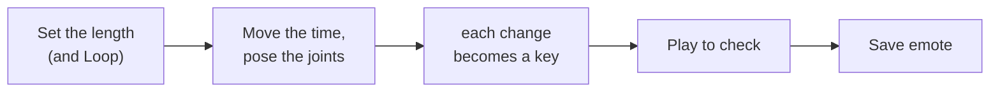

# Emotes

[← Modding guide](README.md)

An **emote** is an animation a player plays from the **emote wheel** — a wave, a dance, a taunt. It's one file, an
**emote pack** (`.fgemote`), made for one character.

- [Playing emotes](#playing-emotes)
- [Making one in the Skin Studio](#making-one-in-the-skin-studio)
- [Making one in Blender](#making-one-in-blender)
- [The emote pack format](#the-emote-pack-format)
- [Putting emotes in a mod](#putting-emotes-in-a-mod)

---

## Playing emotes

In a level, with the HUD up:

| | Open the wheel | Point | More pages | Play |
|---|---|---|---|---|
| **Controller** | hold **BACK** | left stick | **LB / RB** | let go of BACK |
| **Keyboard & mouse** | hold **B** | mouse | mouse wheel | let go of B |

- The wheel shows the emotes **for the character you're playing**, in name order, eight to a page.
- **Only the joints an emote moves** leave the game's animation. A wave that moves just an arm plays while you walk
  and shoot.
- An emote that **loops**, or moves the **hips or legs**, stops when you move.
- Picking the emote that's playing again stops it.
- **Online, everyone sees it.** Players who have the same emote play it from their own copy; the others are sent it
  first (in 1 KB pieces), then see it.

---

## Making one in the Skin Studio

Pick a character and outfit, and open the **Emotes** tab.



| Section | Control | What it does |
|---|---|---|
| **Emote** | **Length** | How long it lasts, in seconds. |
| | **Loop** | Plays again and again until the player moves. |
| **Pose** | Click a dot | Picks that joint (the dots are the skeleton's joints, named *Hips, Spine, Head, Arm L 1, Hand R, Finger …*). |
| | Drag the rings | Turns the joint. |
| | **Move instead of turn** | Moves the joint instead (for the hips: crouching, jumping). |
| | **Reset joint** | Back to its rest pose. |
| **Keys** | **Set key** / **Delete key** | Every change you make becomes a key at the timeline's time; these add or remove one by hand. |
| | **←  →** | Jump to the previous / next key. |
| | **Clear all** | Start over. |
| **Other programs** | **Export rigged .glb** | The character with its skeleton, for Blender. |
| | **Import animation** | An animation from a `.glb` (see below). |
| **Emote pack** | **Save emote** | Saves `<name>.fgemote`. |
| | **Open emote** | Opens one to change it. |

Between keys, joints turn smoothly. Joints you never touch keep the game's own animation in the game.

---

## Making one in Blender

1. In the Emotes tab, **Export rigged .glb** and import it into Blender.
2. Animate the armature. **Keep the bone names** (`bone00`, `bone01`, …): that's how the Studio matches them.
3. Export as **glTF Binary (.glb)** with the animation.
4. Back in the Emotes tab, **Import animation**, check it with **Play**, and **Save emote**.

---

## The emote pack format

A `.fgemote` is a zip with two entries, both **stored**:

```
Wave.fgemote
├── emote.json
└── motion.bin
```

### emote.json

```json
{
  "format": 1,
  "name": "Wave",
  "character": "Stewie",
  "outfit": "Default",
  "model": "Stewie_Rig_Geo",
  "models": [[53, 513], [43, 513]],
  "uses": [19, 20, 21, 22],
  "bones": 47,
  "duration": 2,
  "loop": false,
  "fps": 30,
  "keys": [ … ],
  "tool": "FGUY Skin Studio"
}
```

| Field | Read by the game | Meaning |
|---|:---:|---|
| `name` | ✅ | Its name on the wheel. Emotes are sorted by it. |
| `character` | ✅ | Its character. |
| `models` | ✅ | The character's outfits (model asset ids `[lo, hi]`) it plays on — all of them, normally: they share one skeleton. |
| `uses` | ✅ | The **game** bones it moves. Every other bone keeps the game's animation. Empty or missing: all bones. |
| `loop` | ✅ | Loops until the player moves. |
| `legs` | ✅ | Stops when the player moves. Also true when it moves game bone 1 (the skeleton's root, the hips). |
| `bones`, `duration`, `fps` | | For your reference (the motion holds them). |
| `keys` | | The Studio's keys, so it can open the emote again. |

> [!NOTE]
> **Game bones and skeleton bones.** The game's pose has one more bone than the skeleton: game bone 0 is the
> character's root (where the game places it). So skeleton bone *n* is game bone *n + 1*. `uses` and `motion.bin`
> are in game bones.

### motion.bin

Little endian:

| Part | Type | Meaning |
|---|---|---|
| magic | `char[4]` | `FGMO` |
| version | `int32` | `1` |
| bones | `int32` | game bones per frame (the skeleton's + 1) |
| frames | `int32` | how many frames |
| frame × frames | | `float` time (seconds), then per bone: rotation `x y z w`, translation `x y z`, scale `x y z` — 10 floats, in its parent's space |

The first bone (the root) should stay at the identity (`0 0 0 1`, `0 0 0`, `1 1 1`): the game places the character.
The Studio writes 30 frames a second.

---

## Putting emotes in a mod

Put emote packs in your mod's `emotes\` folder — any number, for any characters:

```
MyEmotes\
├── mod.ini          Type=cosmetic
└── emotes\
    ├── Stewie_Wave.fgemote
    └── Peter_Dance.fgemote
```

Pack it with the Skin Studio's **Save as mod** (add the emote packs), or `tools/make_fgmod.py` on the folder. Loose packs in `FGUYMod\emotes\` work too (for testing).

> [!TIP]
> Emotes are `cosmetic`: they only change how a character looks for a moment. Online, everyone sees them whether
> or not they have your mod.
