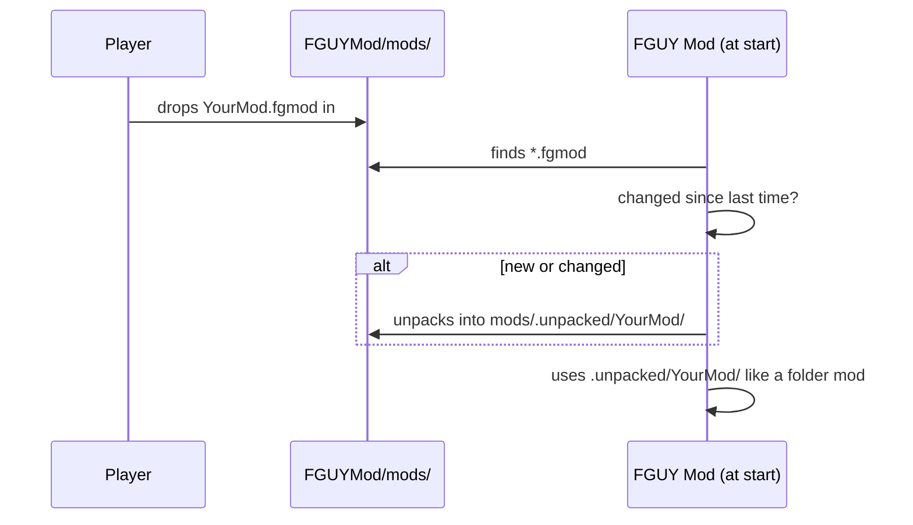

# Mod structure

[← Modding guide](README.md)

A mod is either **one file** (`YourMod.fgmod`) or **one folder** (`YourMod\`) in `FGUYMod\mods\`. Both hold the same
things; the file is simply the folder packed up.

## Contents

```
YourMod\
├── mod.ini            required — what the mod is
├── skins\*.fgskin     skin packs (and the outfits they carry)
├── emotes\*.fgemote   emote packs
├── ui\*.fgpatch       patches for the game's menu and HUD movies
├── files\...          your own versions of game files
└── yourmod.dll        a plugin: your own code
```

Everything except `mod.ini` is optional. Use only the parts you need.

| Part | Read | Details |
|---|---|---|
| `mod.ini` | at start | [below](#modini) |
| `skins\` | while playing (looked at again every few seconds) | [Skins](skins.md) |
| `emotes\` | while playing | [Emotes](emotes.md) |
| `ui\` | at start | [Menu & HUD patches](ui-patches.md) |
| `files\` | whenever the game opens a file | [below](#files--replacing-game-files) |
| plugin DLL | at start, as the game opens its window | [Plugins](plugins.md) |

## mod.ini

```ini
[Mod]
Name=Better Movement
Version=1.0
Author=you
Description=Slide, slide cancel, tactical sprint.
Type=gameplay
Plugin=movement.dll

[Settings]
SlideSpeed=140
```

### `[Mod]`

| Key | Default | Meaning |
|---|---|---|
| `Name` | the folder / file name | Shown on the MODS page. |
| `Version` | `1` | Shown on the MODS page. For gameplay mods it's also part of the online check: players need the same version. |
| `Author` | — | Shown on the MODS page. |
| `Description` | — | Shown on the MODS page. One line. |
| `Type` | `gameplay` | `gameplay` or `cosmetic` — see [below](#gameplay-or-cosmetic). |
| `Plugin` | — | A DLL in the mod to load (a file name, relative to the mod). |
| `DefaultOn` | `0` | `1`: the mod starts **on** until the player switches it off. New mods start off otherwise. |

> [!TIP]
> Keep the folder (or file) name stable between versions. Whether a mod is on is remembered by that name
> (in `FGUYMod\mods.ini`), so renaming it switches it off for everyone who updates.

### `[Settings]`

Anything you like, as `Key=number`. Plugins read them with `api->Setting(L"Key", default)`. Players can edit them in
Notepad (in a folder mod; in a `.fgmod`, they'd edit the unpacked copy — so prefer a folder mod for settings players
are meant to change, or read your own settings file).

### Gameplay or cosmetic?

| | `Type=gameplay` | `Type=cosmetic` |
|---|---|---|
| Changes how the game **plays** | ✅ | ❌ never |
| Online, everyone in a lobby needs it | ✅ same name, version and files | ❌ |
| The lobby lets you in with different ones | ❌ it tells you which mods the host has | ✅ |
| Examples | new moves, weapon changes, new rules | skins, emotes, sounds, a HUD look |

> [!WARNING]
> **Only use `cosmetic` when the mod really can't change the game.** Online matches are lockstep: a "cosmetic"
> mod that moved a wall, changed a hit box or a timer would make the match play differently on each PC, and it
> would go out of sync. See [Online play](online.md).

## One file: `.fgmod`

Pack a mod folder into one file with:

```bash
python tools/make_fgmod.py path/to/YourMod            # → path/to/YourMod.fgmod
python tools/make_fgmod.py path/to/YourMod out.fgmod  # → a name of your choice
```

What happens to it:



- The file is unpacked again **only when it changes** (its size and time are remembered), so starting the game
  stays fast.
- **A file and a folder with the same name:** the file is used and the folder is left out (the log says so). An
  update can therefore safely ship a `.fgmod` over an older install's folder.
- The format is a zip with every entry *stored* (not compressed). `make_fgmod.py` writes the entries in name order
  with a fixed date, so the same folder always makes the same file — handy for the online check, which hashes the
  mod's files.
- Names starting with `.` are left out when packing.

> [!NOTE]
> Compressed zips aren't read — always pack with `make_fgmod.py` (a zip made by Windows or 7-Zip would be
> compressed). The log tells you which entries it couldn't read.

## files\ — replacing game files

`files\<path>` is used instead of the game's own `<path>`, where `<path>` is relative to the game folder:

| Your mod has | The game opens it instead of |
|---|---|
| `files\FGUY\Global_Scenes\X.ho` | `FGUY\Global_Scenes\X.ho` |
| `files\FGUY\Levels\Y.ho` | `FGUY\Levels\Y.ho` |

- Any path the game opens works this way.
- **Two mods replacing the same file:** the mod whose name comes **later in the alphabet** wins.
- The first 50 replacements are written to the log (`Mods: <file> uses <mod>'s <path>`).

> [!CAUTION]
> Don't put the game's own files in `files\`, changed or not, and share them. Share only files you made yourself —
> or a tool that makes them from the player's own game.

## Load order, in short

1. At start: every `.fgmod` is unpacked if needed, every mod's `mod.ini` read, the on / off state read from
   `FGUYMod\mods.ini`.
2. Menu patches: the base mod's first, then each mod's that's on, in name order. A patch can build on the patches
   applied before it — see [Menu & HUD patches](ui-patches.md#stacking-patches).
3. As the game opens its window: each plugin that's on is loaded and its `FGUYModInit` called.
4. While playing: skins and emotes are read from the mods that are on, then from the loose `FGUYMod\skins\` and
   `FGUYMod\emotes\` folders.

Switching a mod on or off on the MODS page takes effect at the **next start** (the page says so).

## The MODS page

*Main Menu › MODS* lists:

- **Mods** — name, version, author, a **GAMEPLAY** or **COSMETIC** badge, and **ON / OFF**.
- **Loose skin packs** from `FGUYMod\skins\` and the skins inside mods — with a **SKIN** badge. **ON** means: worn
  whenever that outfit is played offline, and picked for it online. One skin per outfit.
- **Y** opens `FGUYMod\mods\` in Explorer.
