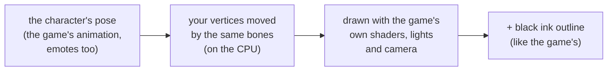

# Outfits & models

[← Modding guide](README.md)

A **model pack** (`.fgmodel`) puts your own 3D model on a character. It moves with the character's skeleton, so it
walks, jumps, fights and emotes with them. There are two kinds:

| Kind | What the game draws | Example |
|---|---|---|
| **Worn over** (outfit pieces) | The character **and** your pieces on top | Peter: Adventurer — hat, vest, boots, pendant, sheath |
| **Instead of** (a new character) | **Only** your model, in the character's place | A robot that plays as Stewie |

A model is worn **through a skin pack**: in the Skin Studio's Skins tab, **Wear a model with it** adds it to the
skin, and the game puts it on and takes it off with the skin — online too.

> **Where does the `.fgmodel` file go?** Nowhere on its own — the game doesn't read loose `.fgmodel` files, and it
> doesn't need a folder or a `mod.ini`. Put it in a skin: Skins tab › pick the character's outfit › **Wear a model
> with it** › choose the `.fgmodel` › **Save skin pack**. Then put the `.fgskin` in `FGUYMod\skins\` (just for you), or
> in a mod's `skins\` folder to share it as a mod ([Mod structure](mod-structure.md)).

- [Making the model](#making-the-model)
- [The Models tab](#the-models-tab)
- [How the game draws it](#how-the-game-draws-it)
- [The model pack format](#the-model-pack-format)
- [Tips](#tips)

---

## Making the model

Any program that exports **glTF binary (`.glb`)** works — Blender (*File › Export › glTF 2.0*, format *glTF
Binary*), or a generator such as [img2threejs](https://github.com/img2threejs/img2threejs), which builds a model from
a picture.

**Start from the character.** In the Skin Studio's **Emotes** tab, **Export rigged .glb** saves the character in its
rest pose, with its skeleton. Import that into Blender and model *on* it: your outfit then has the right size and
place from the start, and the Studio keeps it exactly where you made it.

What the Studio reads from your `.glb`:

| From the .glb | Used as |
|---|---|
| Meshes (every primitive) | The model's parts |
| A material's base colour texture | That part's texture (your own picture) |
| A material's colour / vertex colours (no texture) | Put on a small palette texture the Studio makes |
| A skin whose bones are named `bone00`, `bone01`, … (as the Studio's export names them) | The model's own weights — kept as they are |
| No skin | Weights copied from the character (below) |

**Limits:** 65,535 vertices in all; up to 1,024 flat colours without textures. Keep it light — Peter's own body is
about 8,700 triangles, and Peter: Adventurer adds about 19,600.

> [!IMPORTANT]
> Everything in a model pack must be your own work: your meshes, your textures. Don't put the game's models or
> textures in one.

---

## The Models tab

1. Pick the character and outfit on the left, then **Import .glb**.
2. **The character** shows the character as *solid*, *x-ray* or *hidden*, to see your model against it.
3. **Fit it:**

   | Control | Meaning |
   |---|---|
   | **Made on this character already: keep its size and place** | Your model was made on the exported character: used exactly as it is. Ticked by itself when the model sits inside the character's box. |
   | **Fit to the body's shape** | For a model made elsewhere: it's stretched to the character's arms, torso and head. |
   | **Size, Left, Up, Forward, Turn** | Adjust by hand. |
   | **Fit automatically** | Back to the automatic fit. |
   | **Try a pose** | Arms down and out, head turned — see how it bends. Click again for the rest pose. |

4. **Worn over the character** — tick it for outfit pieces (the character stays), leave it off for a new character.
5. Name it and **Save model**: you get `<name>.fgmodel`.
6. On the **Skins** tab, **Wear a model with it** and pick that file, then save the skin pack.

### How weights are copied

For a model without its own skin, every vertex gets bones from the character:

- **Worn over:** from the character's surface right *beneath* the vertex (along its normal) — a boot's toe follows
  the foot under it, its top the shin.
- **Instead of:** from the character's nearest vertices.

Then, for outfit pieces:

- **A piece sitting on a bigger piece** (a lace on a boot, a button on a pocket, a band on a hat) takes that piece's
  weights exactly, so it never sinks into it as it bends.
- **A piece that mostly follows one bone** (70% of its weight or more — a hat on the head, a sheath on the hips)
  follows that bone alone, rigidly.
- Everything else keeps the character's weights, without the faintest ones (under 2%).

### Hiding the body under the outfit

For worn-over models, the Studio also lists **the character's own triangles that are deep inside a solid part of
your model** — a leg inside a boot, a head inside a hat. The game leaves those out while your model is worn, so the
body never pokes through as both move. (*The character › hidden* shows what's left out.)

A triangle is hidden when two of its corners are inside a solid part — inside on every axis, at least 0.004 units from
its surface, and the part at least 0.12 units thick there. Thin shells like a vest hide nothing.

### Nothing of the character showing through

Thin shells hide nothing, so the Studio makes sure they sit **outside** the character instead: wherever your model is
inside the character's drawn surface, or closer than 0.008 units to it, it's moved out along the character's normal to
0.008 off it (three rounds, up to 0.15 units — a part meant to be deep inside stays). The model's vertices nearby go
with it (fully within 0.03, fading out by 0.06), so a shell keeps its thickness and a button stays on its pocket.
Where the character is hidden under a solid part, nothing needs to move.

---

## How the game draws it



- **Every frame**, your model is posed exactly like the character — the game's animations, emotes, everything.
- It's drawn with the **game's own shaders**, so it's lit and cel-shaded like the rest of the game.
- **Ink outlines:** the game draws its black sketch lines only around its own pieces, so the mod gives yours an
  outline of its own (an inflated, inside-out copy in black). The smallest parts — under 0.07 units across, like laces or
  rivets — get none, or they'd be black blobs.
- **Worn over:** the character is drawn as usual (minus the hidden triangles), your pieces with it.
  **Instead of:** the character's pieces and ink lines aren't drawn at all.

---

## The model pack format

A `.fgmodel` is a zip with every entry **stored**:

```
Peter_Adventurer.fgmodel
├── model.json
├── mesh.bin
└── textures\0.png …
```

### model.json

```json
{
  "format": 1,
  "name": "Peter Adventurer",
  "character": "Peter",
  "models": [[6258, 49], [557, 513]],
  "bones": 59,
  "textures": ["textures/0.png"],
  "over": true,
  "hide": [
    {"verts": 4343, "indices": 15510, "tris": [0, 2, 36, 2, 51, 1]}
  ],
  "tool": "FGUY Skin Studio"
}
```

| Field | Meaning |
|---|---|
| `format` | `1` |
| `name`, `character` | Its name and character. |
| `models` | The outfits (model asset ids `[lo, hi]`) it's for. All of a character's outfits share one skeleton, so a model can fit several. |
| `bones` | The game's bone count for the character (the skeleton's bones + 1: the game's bone 0 is the root). |
| `textures` | The PNGs in the pack, in order — a part's texture number indexes this list. |
| `over` | `true`: worn over the character. `false` / missing: drawn instead of it. |
| `hide` | The character's triangles to leave out while it's worn: per piece of the character (found by its vertex and index counts), `tris` is a list of `first, count` pairs of triangle numbers. |

### mesh.bin

Little endian:

| Part | Type | Meaning |
|---|---|---|
| magic | `char[4]` | `FGMD` |
| version | `int32` | `1` |
| S, P, V, I | `int32` × 4 | bones, parts, vertices, indices |
| parents | `int8` × S | each skeleton bone's parent (`-1` for a root). A parent always comes before its children. |
| inverse binds | `float` × 12 × S | each bone's inverse bind matrix, 3 × 4 row-major (translation in each row's 4th value) |
| parts | (`uint32` first index, `uint32` index count, `uint32` texture) × P | ranges of `indices`, each drawn with one texture |
| vertices | × V | position `float[3]`, normal `float[3]`, uv `float[2]`, bones `uint8[4]`, weights `uint8[4]` (adding up to 255) |
| indices | `uint16` × I | triangle list |

Positions are in the character's space (its feet at y = 0, facing +z; Peter is about 1.9 units tall). A vertex's bone numbers are
**skeleton** bones (the game's bone n + 1).

You can also make a pack from a rigged `.glb` from the command line:

```bash
py tools/re/glb2fgmodel.py robot.glb Robot.fgmodel --name "Robot Stewie" --character Stewie --models 53,513
```

---

## Tips

- **Model on the exported character** — it saves you all the fitting.
- **Close the gaps.** Pieces worn over the body should sit a little outside it (a few millimetres); the hide list
  takes care of what's deep inside.
- **Separate small parts** (buttons, laces) as their own meshes: they then ride the piece they're on.
- **Flat colours suit the game.** It's cel-shaded: a few flat colours per part look more like the game than
  detailed textures.
- **Check the pose** with *Try a pose*, and in the game with emotes, before you release it.
- **Look in the log**: `Models: <name> - <vertices>, <triangles>, … worn over the character (<n> of their pieces
  partly under it)` tells you it loaded.
