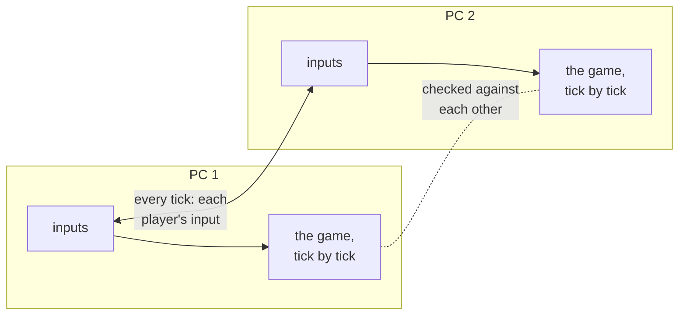
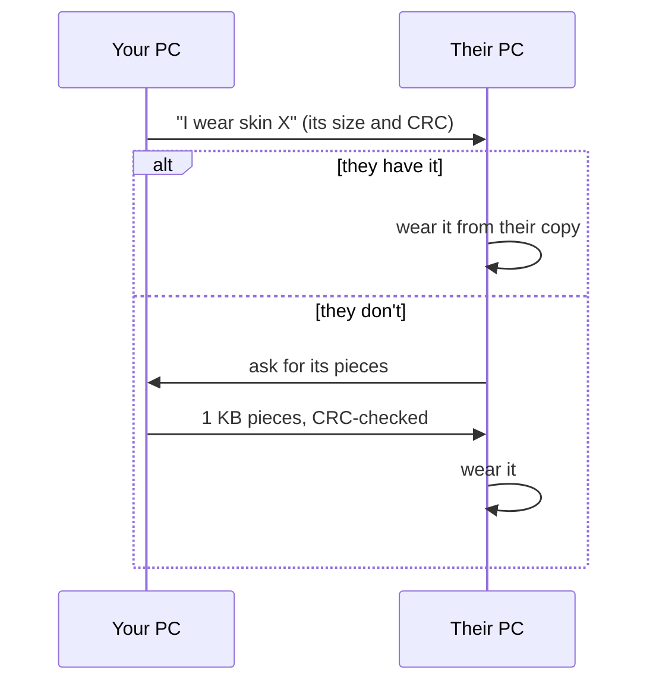

# Online play

[← Modding guide](README.md)

What every modder should know about how mods behave in online matches.

## How a match runs



Online matches are **lockstep**. The PCs don't send each other the game's state — only every player's input, tick by
tick. Each PC then runs the *same game* from the *same inputs*, so they all show the same match. This keeps matches
smooth with very little data, but it means:

> [!IMPORTANT]
> **Anything that changes the game must happen the same way on every PC.** If one PC's game differs even a little —
> a player slightly elsewhere, one more point of damage — the matches drift apart ("desync"). The base mod checks
> the players' positions, health, money and the game's random numbers between PCs all the time; when they differ it
> ends the match and saves a report in `FGUYMod\reports\`.

## What has to match

| | Has to match between players? | How the mod handles it |
|---|---|---|
| The FGUY Mod itself | ✅ the same version | The lobby server only matches players with the same version. |
| **Gameplay** mods (`Type=gameplay`) | ✅ the same mods, versions and files | The lobby turns away players whose gameplay mods differ from the host's, and tells them which mods the host has. |
| **Cosmetic** mods (`Type=cosmetic`) | ❌ | Each player can have different ones. |
| Your **skin** | ❌ | Sent to everyone when the match starts. They don't need your mod. |
| Your skin's **outfit pieces** (model) | ❌ | Travel inside the skin pack. |
| **Emotes** you play | ❌ | Played from the others' own copy if they have it, otherwise sent to them first. |

### How gameplay mods are compared

Each player's game sends the lobby server a key made of their **gameplay mods that are on**:
`<name>@<version>#<hash>` for each, where the hash covers every file of the mod (`mod.ini`, the plugin, `ui\`,
`files\`). Two players match only when their keys are the same. So:

- Players need **exactly the same files** — the same `.fgmod`. Don't let players edit a gameplay mod's files (or
  its `[Settings]`) if they want to play together.
- Raising `Version` makes it clear to players that they need the update — the lobby tells them the host's version.

## Making a gameplay mod online-safe

The full rules are in [Plugins › The rule for online play](plugins.md#the-rule-for-online-play). In short:

1. Change the game **only in `OnTick`** (the game's thread, once per tick).
2. Base every change only on **`GetInput`** (the synced input), **the game's own state**, your **`mod.ini`**, and
   `Tick()`.
3. Never on this PC's own keyboard / mouse / controller, the clock, or your own random numbers.
4. File replacements (`files\`) and menu patches that change gameplay are gameplay mods too.

## Skins and emotes online



- Packs keep travelling all match long, so players who join late get them too.
- Until a pack has arrived, the others see the game's own outfit (or no emote).
- **Size matters**: a 700 KB skin pack takes about ten seconds. Keep packs small — see [Skins › Tips](skins.md#tips).
- Packs over 16 MB aren't sent.

## The lobby server

Players connect to a lobby server (`FGUYMod\FGUYMod.ini` › `[Online]` › `Server=host:port`). It only puts players
together and helps their games reach each other; the match itself runs between the players' PCs.

You can run your own — for testing, or for your community. It's one Python file with no dependencies:

```bash
python server/fguy_lobby.py --port 7650
```

Then set `Server=127.0.0.1:7650` (same PC) or your server's address in `FGUYMod.ini`. See
[`server/README.md`](../server/README.md) for running it on a server.
