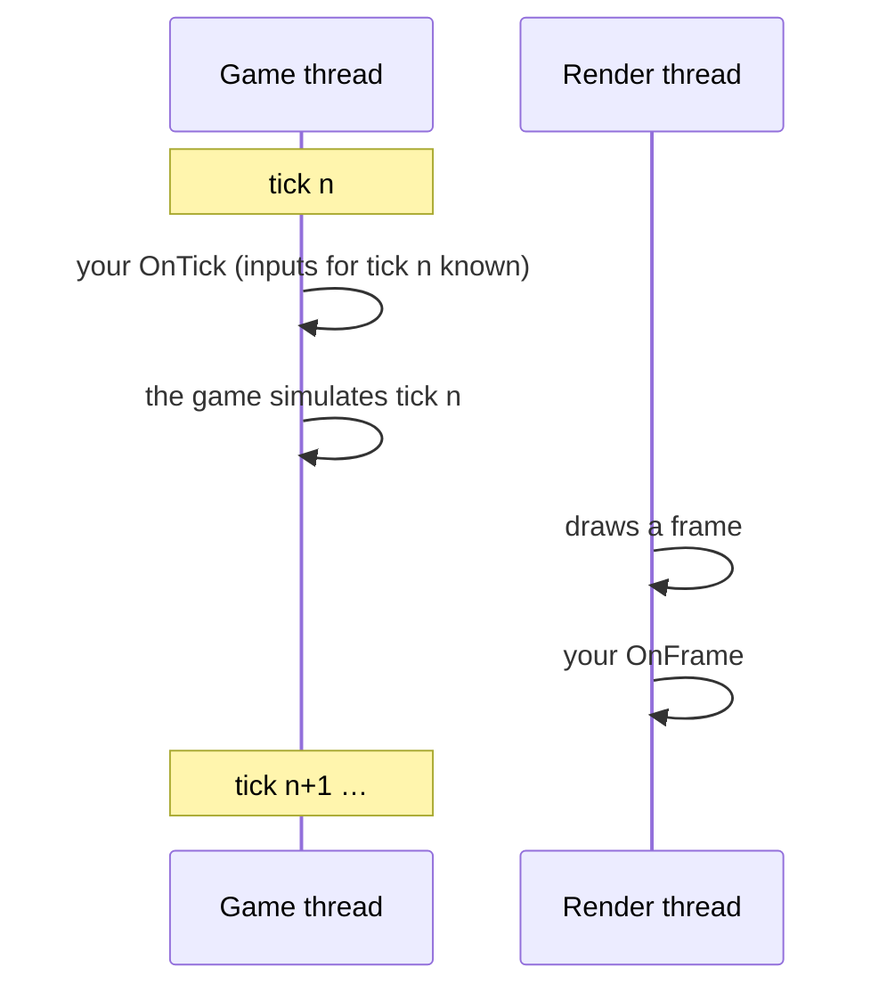

# Plugins

[← Modding guide](README.md)

A **plugin** is your own code: a Windows DLL inside your mod that the base mod loads into the game. With it you can
read and change anything — players, input, the game's own functions.

- [Your first plugin](#your-first-plugin)
- [The API](#the-api)
- [Threads and timing](#threads-and-timing)
- [Hooking the game's code](#hooking-the-games-code)
- [The rule for online play](#the-rule-for-online-play)
- [Finding your way around the game](#finding-your-way-around-the-game)
- [Debugging](#debugging)

> [!IMPORTANT]
> The game is **32-bit**, so your DLL must be too (`x86`, not `x64`).

---

## Your first plugin

The SDK is in [`sdk/`](../sdk/): the header [`fguymod_plugin.h`](../sdk/fguymod_plugin.h) and a complete
[`example`](../sdk/example/).

```cpp
#include <windows.h>
#include "fguymod_plugin.h"

static const FGUYModAPI* g_api;

static void OnTick(void*) {
    void* players[8];
    int n = g_api->GetPlayers(players, 8);
    for (int i = 0; i < n; ++i) {
        float* pos = g_api->PlayerPosition(players[i]);
        // ... read the game, change the game (see "The rule for online play")
    }
}

extern "C" __declspec(dllexport) int FGUYModInit(const FGUYModAPI* api) {
    if (!api || api->version < 1) return 0;   // (an older base mod)
    g_api = api;
    api->Log(L"hello");
    api->OnTick(OnTick, nullptr);
    return 1;                                  // 1: started; anything else: failed (the log says so)
}
```

`mod.ini`:

```ini
[Mod]
Name=My Plugin
Version=1.0
Type=gameplay
Plugin=myplugin.dll
```

### Building

With **Visual Studio 2022**, from an *x86 Native Tools Command Prompt* (or see [`sdk/example/build.bat`](../sdk/example/build.bat)):

```bat
cl /nologo /O2 /MT /W4 /EHsc /LD myplugin.cpp /Fe:myplugin.dll /link user32.lib
```

- `/LD` makes a DLL, `/MT` puts the C runtime inside it (players needn't install anything).
- Put `myplugin.dll` next to `mod.ini`, pack the mod (or use the folder), switch it on on the MODS page, restart.
- The log shows `Mods: My Plugin - plugin started`, then your `Log` lines as `Mod My Plugin: …`.

---

## The API

`FGUYModInit` gets a pointer to `FGUYModAPI`. Keep it: it stays valid for as long as the game runs.

### About the mod

| Member | Meaning |
|---|---|
| `int version` | `FGUYMOD_API_VERSION` (2 since 0.9.1). Newer base mods only add members at the end — check it before using a newer member. |
| `const wchar_t* modFolder` | Your mod's folder, no trailing backslash. For a `.fgmod`, its unpacked copy. |
| `void Log(const wchar_t* text)` | A line in the log (`FGUYMod\FGUYMod_<process id>.log`), with your mod's name. |
| `int Setting(const wchar_t* key, int defaultValue)` | `mod.ini` › `[Settings]` › `key`, as a number. |

### The match

| Member | Meaning |
|---|---|
| `int IsOnline()` | `1` in an online match. |
| `int LocalPlayer()` | Online: this PC's player index (0–3). Offline: `0`. |
| `unsigned Tick()` | Online: the match's tick number (the same on every PC). Offline: frames counted. |
| `int TickRate()` | Ticks per second. Online: the match's rate. Offline: measured (the game ticks once per frame drawn). |

### Players

| Member | Meaning |
|---|---|
| `int GetPlayers(void** out, int max)` | The level's players, in player-index order. Returns how many (up to 8). |
| `int PlayerIndex(void* player)` | Its index, 0–3. |
| `float* PlayerPosition(void* player)` | `x, y, z` — **writable**: move the player by writing it. `nullptr` if unknown. |
| `float PlayerHealth(void* player)` | `0`: down; `200`: full. |
| `int GetInput(int playerIndex, FGUYModInput* out)` | That player's input this tick. `1` if known: online every player's; offline only player 0's (this PC's controller and keyboard). |

`FGUYModInput`:

| Field | Meaning |
|---|---|
| `uint16_t buttons` | XInput buttons (`XINPUT_GAMEPAD_A`, …) |
| `uint8_t leftTrigger, rightTrigger` | 0–255 |
| `int16_t leftX, leftY, rightX, rightY` | sticks, −32768–32767 |
| `int keyboardPlayer` | `1`: this player plays with keyboard and mouse |
| `uint8_t keys[32]` | key `vk` is down when bit `vk & 7` of `keys[vk >> 3]` is set |
| `int16_t mouseX, mouseY` | mouse movement this tick |
| `int16_t mouseWheel` | wheel movement this tick |
| `uint8_t mouseButtons` | `1` left, `2` right, `4` middle |

```cpp
FGUYModInput in;
if (api->GetInput(0, &in)) {
    bool jump  = in.buttons & XINPUT_GAMEPAD_A;
    bool shift = in.keys[VK_SHIFT >> 3] & (1 << (VK_SHIFT & 7));
}
```

### Callbacks

| Member | When |
|---|---|
| `int OnTick(FGUYModCallback fn, void* user)` | Every game tick, **on the game's thread**, just before the game runs it. *The* place for gameplay changes. |
| `int OnFrame(FGUYModCallback fn, void* user)` | Every frame the game draws, on the render thread. For visual things. |

`FGUYModCallback` is `void (*)(void* user)`; `user` is handed back to you.

### Changing the game's code

| Member | Meaning |
|---|---|
| `int Hook(void* target, int length, void* detour, void** original)` | Detours a function — see [below](#hooking-the-games-code). |
| `int Patch(void* address, const void* bytes, int length)` | Writes bytes into the game's code (the page made writable, the instruction cache flushed). |

### Menu calls *(API 2)*

| Member | Meaning |
|---|---|
| `int OnMenuCall(const char* name, FGUYModMenuFn fn, void* user)` | Your own call for menu and HUD scripts: `ExternalInterface.call('FGUYPLUGIN_<name>', …)` reaches `fn`. `name`: letters, digits, `_` (up to 48); the first mod to take a name keeps it. |

`FGUYModMenuFn` is `int (*)(void* user, const char* const* args, int argc, char* out, int outSize)`:

- `args` — the script's arguments as text (numbers as decimals, booleans as `true` / `false`), up to 16.
- Write the answer into `out` (nul-terminated, up to `outSize` bytes) and return `1`: the script gets it as a string.
  Return `0`: the script gets `undefined`.
- It runs on the thread the menu runs on — keep gameplay changes in `OnTick`.

```cpp
static int Hello(void*, const char* const* args, int argc, char* out, int outSize) {
    sprintf_s(out, outSize, "%s - tick %u", argc > 0 ? args[0] : "", g_api->Tick());
    return 1;
}
// in FGUYModInit:
if (api->version >= 2) api->OnMenuCall("MyHello", Hello, nullptr);
```

…and in your menu patch's code (see [Menu & HUD patches](ui-patches.md)):

```js
var text = String(flash.external.ExternalInterface.call('FGUYPLUGIN_MyHello', 'hi'));   // "hi - tick 2214"
```

A call no plugin answers gives `undefined` (and one line in the log).

---

## Threads and timing



- **`FGUYModInit`** runs once, early — as the game opens its window, before its menus and levels. There are no
  players yet: just set things up and register callbacks.
- **`OnTick`** runs on the game's thread. Online, it runs right after the match has every player's input for that
  tick, so `GetInput` gives the synced input.
- **`OnFrame`** runs on the render thread. Don't change gameplay state there.
- Return quickly from callbacks: they run every tick / frame.

---

## Hooking the game's code

```cpp
using Damage_t = void(__thiscall*)(void* self, float amount);
static Damage_t g_original;

static void __fastcall MyDamage(void* self, void* /*edx*/, float amount) {
    g_original(self, amount * 0.5f);   // half damage
}

// in FGUYModInit:
api->Hook(reinterpret_cast<void*>(0x00512340), 0, reinterpret_cast<void*>(&MyDamage),
          reinterpret_cast<void**>(&g_original));
```

*(The address is made up — find real ones as described [below](#finding-your-way-around-the-game).)*

How `Hook` works:

- The first instructions at `target` are moved to a **trampoline**, and `target` jumps to your `detour`.
  `*original` gets the trampoline: call it to run the game's own function.
- **`length = 0`** (recommended): the base mod picks as few whole instructions as cover the 5-byte jump. Otherwise
  `length` must be at least 5 and end on an instruction boundary.
- Relative calls and jumps among the moved instructions are fixed up (short ones made long).
- It refuses — returns `0`, and the log says why — when `target` isn't the start of an instruction, a given length
  ends inside one, there's a `ret` / `jmp` within the first 5 bytes, something jumps back into the moved bytes, or it
  meets an instruction it can't decode.

> [!TIP]
> The game uses `__thiscall` for member functions (the object in `ecx`). Write your detour as `__fastcall` with an
> unused second parameter (it receives `edx`), as above.

---

## The rule for online play

Online matches are **lockstep**: every PC runs the same game from the same inputs, tick by tick. A gameplay plugin
must therefore make **exactly the same changes on every PC**.

| ✅ Base gameplay changes on | ❌ Never base them on |
|---|---|
| `GetInput` — the match's synced input | This PC's own keyboard, mouse or controller (`GetAsyncKeyState`, XInput…) |
| The game's own state (positions, health, …) | The clock (`GetTickCount`, `time`, frame times) |
| Your `mod.ini` | Your own random numbers (`rand`, `std::random_device`) |
| `Tick()` and `TickRate()` | Anything about this PC (window size, files that differ) |

…and make them **only in `OnTick`**.

If you need randomness, derive it from things every PC shares — for example a hash of `Tick()` and a player index.

What happens if you don't: the match plays differently on each PC. The base mod checks for this all the time — it
compares the players' positions, health, money and the game's random numbers between PCs — and when they differ it
ends the match and saves a report in `FGUYMod\reports\`. Purely visual changes (`OnFrame`) may use anything.

Also remember to set **`Type=gameplay`** — then the lobby makes sure everyone has the same version of your mod. See
[Online play](online.md).

---

## Finding your way around the game

- **[`RESEARCH_NOTES.md`](../RESEARCH_NOTES.md)** — everything found so far: addresses of the game's functions and
  data, how players, cameras, input, menus, the netcode and the characters work.
- **The base mod's source** in [`src/loader/`](../src/loader/) — real, working hooks of many of the game's functions.
- **The game version:** the retail PC `FGUY.exe` (SHA-256 starts `E4BCD19E`). Addresses are for that exe; the
  base mod checks the bytes before it hooks anything, and your plugin should too.
- **Tools:** a disassembler / decompiler such as Ghidra (free) or x32dbg; [`tools/re/`](../tools/re/) has scripts to
  read the game's `.ho` packages and more.

Useful starting points from the notes:

| What | Where |
|---|---|
| The live player list | `[0xbad988]`: up to 8 player pointers, the count at `+0x20` |
| A player's position | `[player + 0x38] + 0x30` (3 floats) — what `PlayerPosition` returns |
| A player's index | `player + 0xdf8` — what `PlayerIndex` returns |

---

## Debugging

- **The log** — `FGUYMod\FGUYMod_<process id>.log`, a new one each start. Your `Log` lines, which mods loaded,
  whether your plugin started, every hook the base mod refused and why.
- **A debugger** — attach Visual Studio (*Debug › Attach to Process › FGUY.exe*) or x32dbg to the running game; build
  your DLL with `/Zi` for symbols.
- **Crashes** — if `FGUYModInit` crashes, the game does too. Check `api->version`, check pointers, and test
  offline first.
- **Online** — test with two copies of the game on one PC (see [Testing](testing.md)) and look for `DESYNC` in
  the logs.
