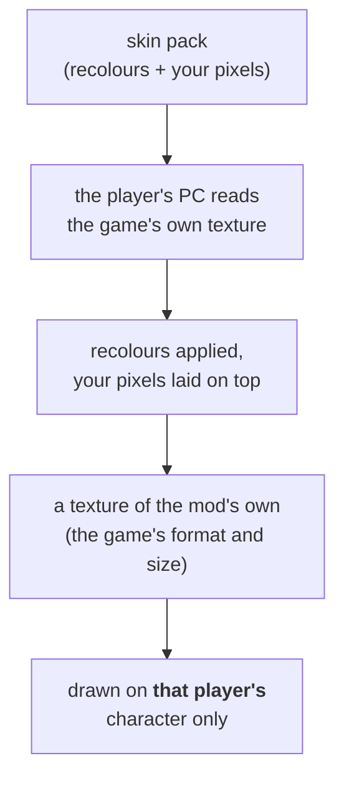

# Skins

[← Modding guide](README.md)

A **skin** changes how a character's outfit looks: its colours, painted details, and — optionally — 3D outfit
pieces worn over it ([Outfits & models](models.md)). A skin is one file, a **skin pack** (`.fgskin`).

- [The Skin Studio](#the-skin-studio)
- [How a skin is worn](#how-a-skin-is-worn)
- [The skin pack format](#the-skin-pack-format)
- [Putting skins in a mod](#putting-skins-in-a-mod)
- [Tips](#tips)

---

## The Skin Studio

Start it as described in [Getting started](getting-started.md#the-skin-studio), click **Open game folder**, and pick
a character and outfit on the left. The **Skins** tab is where skins are made.

### The view

- **Drag** to turn the character, **scroll** to zoom.
- **Click the character** to pick the colour under the mouse.
- **Show battle damage** shows the torn-clothes pieces the game draws when the character is hurt.
- **In-game look** shows it as the game draws it: flat cel shading and black ink outlines.

### Recolouring

1. Click a colour on the character or on its texture (the **Textures** list shows every texture the outfit uses).
2. Choose the new colour.
3. Set **How close**: how similar a colour must be to the one you picked to change too. Low values change only
   that exact colour; high values also catch its shades.
4. Click **Recolor**.

What a recolour does, exactly — pixel by pixel:

```
distance = how far the pixel's RGB is from the picked colour (0 … 441)
if distance > radius: unchanged
weight   = 1 within 60% of the radius, fading to 0 at the radius (a soft edge)
new      = the new colour's hue,
           the pixel's saturation + (new saturation − picked saturation),
           the pixel's lightness  + (new lightness  − picked lightness)
pixel    = mix(pixel, new, weight)
```

So shading painted into the texture is kept: a dark fold of a white shirt becomes a dark fold of a green one.
(*How close* is stored as the radius: the slider's value × 2.2.)

> [!NOTE]
> A recolour also goes to the outfit's **battle damage** textures. They carry their own copy of the clothes'
> colours — without this, the old colour would show through when the character is hurt.

**Undo** steps back one recolour; **Reset texture** starts that texture over.

### Painting your own

**Export PNG** saves the texture; paint on it in any program (Krita, GIMP, Photoshop, Paint.NET); **Import PNG**
brings it back. Keep the same size. Only the pixels you actually changed are saved in the pack (see
[the overlay](#the-overlay)).

### Saving

Under **Skin pack**:

| Option | What it does |
|---|---|
| **Skin name** | The name players see. |
| **Wear a model with it** | Adds a model pack (`.fgmodel`, made in the Models tab) — outfit pieces worn with the skin. See [Outfits & models](models.md). |
| **Show it on the character** | Shows that model in the view. |
| **Skin picture** | A drawing of the skin on a transparent background, shown in the game's menus. See [Pictures](#pictures). |
| **Save skin pack** | Saves `<name>.fgskin`. |
| **Open pack** | Opens a skin pack to change it. |

---

## How a skin is worn



- **Per player.** A skin is worn by one player. Two Peters in a match can wear different skins — or one the game's
  own outfit. The mod tells the players' characters apart while they're drawn.
- **Built on each PC.** The pack doesn't contain the texture itself. Each PC builds it from its own copy of the
  game, when the game has loaded that texture. That's why skin packs are small and safe to share.
- **One skin per outfit.** A skin is made for one outfit of one character (Peter's *Default*, say). It's offered
  only when that outfit is played.

### Picking a skin

| Where | How |
|---|---|
| **Offline** | *Main Menu › MODS*: switch a skin **ON**. Every player who plays that outfit wears it — the menus' characters too. |
| **Online** | The lobby's character screen: pick the character, then the skin's tile (right after its outfit's tile), or press **Y** to go through them. Click the outfit's tile again to take the skin off. |

The pick is remembered per outfit in `FGUYMod\FGUYMod.ini`, section `[Skins]`.

### Online

When a match starts, your skin pack is sent to everyone in it, so **the other players don't need your mod** to see
your skin. Packs travel in 1 KB pieces alongside the match — a 700 KB pack takes around ten seconds, during which
the others see the game's own outfit. Keep packs small (see [Tips](#tips)).

---

## The skin pack format

A `.fgskin` is a zip with every entry **stored** (not compressed):

```
Blue_Stewie.fgskin
├── skin.json                    what it is and what it changes
├── textures\Stewie_Char_CO.png  your own pixels for a texture (optional, one per texture)
├── model.fgmodel                outfit pieces worn with it (optional)
├── icon.png                     its tile in the menus (optional)
└── head.png                     its head on the HUD (optional)
```

### skin.json

```json
{
  "format": 2,
  "name": "Peter Adventurer",
  "character": "Peter",
  "outfit": "Default",
  "model": "Peter_Rig_Geo",
  "modelId": [6258, 49],
  "textures": {
    "Peter_Char_CO": {
      "id": [6256, 49],
      "width": 1024, "height": 1024, "format": "DXT1", "mips": 11,
      "ops": [
        [228, 228, 225,  127, 160, 109,  55],
        [37, 99, 8,      79, 94, 114,    39.6]
      ],
      "overlay": "textures/Peter_Char_CO.png"
    }
  },
  "withModel": "Peter Adventurer",
  "icon": "icon.png",
  "head": "head.png",
  "headFace": [0.2422, 0.9063, 0.9609],
  "tool": "FGUY Skin Studio"
}
```

| Field | Required | Meaning |
|---|:---:|---|
| `format` | ✅ | `2`. (Format 1 packs, which held whole game textures, still load but must not be shared.) |
| `name` | ✅ | The skin's name in the menus. |
| `character` | | The character (`Peter`, `Stewie`, `Brian`, `Lois`, `Meg`, `Chris`, `Quagmire`, `Cleveland`, `AdamWest`, `Death`). Shown on the MODS page. |
| `outfit` | | The outfit's name (`Default`, …). Shown on the MODS page. |
| `model` | | The outfit's model asset name. For your reference. |
| `modelId` | ✅ | The outfit's model asset id `[lo, hi]`: **which outfit the skin is for.** |
| `textures` | ✅ | One entry per changed texture, keyed by the texture's name. |
| `textures.*.id` | ✅ | The texture's asset id `[lo, hi]`. |
| `textures.*.width/height/format/mips` | | The game texture's size, format and mip levels. For your reference — the mod reads them from the game. |
| `textures.*.ops` | | The recolours, in order: `[from R, G, B,  to R, G, B,  radius]`. |
| `textures.*.overlay` | | A PNG in the pack with your own pixels (see below). |
| `withModel` | | The name of the model in `model.fgmodel`, if there is one. |
| `icon` | | Its tile picture (see [Pictures](#pictures)). |
| `head` | | Its HUD head picture. |
| `headFace` | | Where the face is in `head.png`: `[left, right, bottom]`, as fractions of its width / height. |
| `picture` | | The Skin Studio's note that the pictures came from a drawing. |
| `tool` | | What made it. |

> [!TIP]
> You'll rarely write `skin.json` by hand — the Skin Studio does it. But you *can* generate skins with a script:
> copy one the Studio made, change the `ops`, and zip it back up **stored** (Python: `zipfile.ZIP_STORED`).

### The overlay

`textures/<name>.png` is a PNG **the size of the game's texture**, transparent everywhere except the pixels you
painted. It's laid over the texture after the recolours (its alpha blends it in). Because it holds only your own
pixels, it's yours to share.

The Skin Studio writes the overlay for you: every pixel that differs from the recoloured texture by more than a
little is kept, the rest left transparent.

### Pictures

Two optional pictures make a skin look at home in the game's menus:

| File | Size | Where it shows |
|---|---|---|
| `icon.png` | 152 × 212 | The skin's tile on the lobby's character screen, on the game's blue. |
| `head.png` | 128 × 128 | In place of the character's head on the in-game HUD. |

With **Skin picture** in the Studio, both come from one drawing of yours (transparent background): the tile is the
whole drawing; the head is its top, rounded off under the chin. Without one, the Studio draws them from the 3D view
in a flat style.

For the HUD, `headFace` tells the game where the face is, so it can make your face exactly as wide as the
character's own drawn head and put it in the same place — a hat then stands up out of it, as it should.

> [!NOTE]
> The game's menus can't show pictures from a movie directly, so the mod turns your picture into a vector shape
> (flat colours) when it's first shown. Drawings with few, flat colours look best and cost the least. Both
> pictures are reduced to a palette of about 40 colours by the Studio.

---

## Putting skins in a mod

Put skin packs in your mod's `skins\` folder — as many as you like, for any characters:

```
MySkins\
├── mod.ini          Type=cosmetic
└── skins\
    ├── Blue_Stewie.fgskin
    ├── Goth_Meg.fgskin
    └── Peter_Adventurer.fgskin
```

Then pack it with `python tools/make_fgmod.py MySkins`. When the mod is on, its skins are offered just like loose
ones (the MODS page shows which mod each comes from). Updating the mod later with more skins is just a new
`.fgmod` with the same name.

---

## Tips

- **Small packs travel faster online.** The overlay is usually the biggest part: paint only what you need, and
  prefer recolours (a few bytes each) over painting whole areas.
- **One colour at a time.** Several small recolours with a low *How close* give cleaner results than one big one.
- **Check the battle damage** (*Show battle damage*) and the **In-game look** before saving.
- **Same outfit, many skins:** players pick one per outfit, so variants of one outfit compete — name them clearly.
- **Test both ways:** offline (MODS page) and in an online lobby. See [Testing](testing.md).
