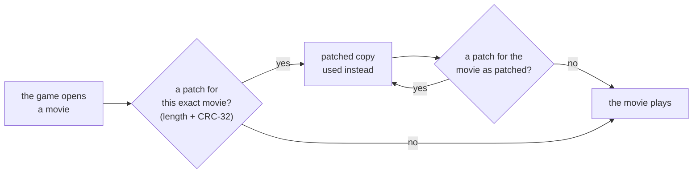

# Menu & HUD patches

[← Modding guide](README.md)

The game's menus and HUD are **Scaleform** movies — Flash with ActionScript 2. A **`.fgpatch`** changes one of them:
its scripts, its layout, anything in it. Patches are applied **in memory** to the player's own copy of the movie
when the game opens it; nothing on disk changes, and a patch holds **only your own bytes**, never the game's.

The base mod uses exactly this for everything it adds to the menus: the ONLINE screens, the MODS page, the online
pause menu, the emote wheel, the skins' HUD heads.

- [How patches are applied](#how-patches-are-applied)
- [The .fgpatch format](#the-fgpatch-format)
- [Making a patch](#making-a-patch)
- [Writing new code with as2c](#writing-new-code-with-as2c)
- [Stacking patches](#stacking-patches)
- [Scaleform in this game](#scaleform-in-this-game)

---

## How patches are applied



- Patches come from `FGUYMod\ui\` (the base mod's) and from the `ui\` folder of every mod that's on.
- A patch names the **exact movie** it was made for: its length and CRC-32. If the game's movie is different (another
  version of the game), the patch is simply not used.
- After a patch is applied, the patches are looked through again: one made for the movie **as already patched**
  applies on top (up to 8 deep).
- The log says `UI: "<movie>.gfx" patched with <file>.fgpatch` for every patch applied.

---

## The .fgpatch format

Little endian:

| Part | Type | Meaning |
|---|---|---|
| magic | `char[4]` | `FGP1` |
| original length | `uint32` | the movie's length (its own size field) |
| original CRC | `uint32` | CRC-32 (zlib's) of the movie |
| edit count | `uint32` | |
| edit × count | `uint32` offset, `uint32` delete length, `uint32` insert length, `bytes[insert length]` | Replace *delete length* bytes at *offset* with these bytes. |

Offsets are in the **original** movie, the edits sorted and never overlapping.

---

## Making a patch

Patches are made with Python, from **your own copy** of the movie, with the tools in [`tools/ui/`](../tools/ui/):

| Tool | What it's for |
|---|---|
| `gfxpatch.py` | `Patch` (collects edits, writes the `.fgpatch`), finding functions in a movie's scripts, fixing up lengths and jumps after an edit |
| `as2c.py` | A small compiler: JavaScript-like code → ActionScript 2 bytecode |
| `as2asm.py` | An assembler, for small hand-made inserts |
| [`tools/re/swf.py`](../tools/re/swf.py) | Lists a movie's tags |
| [`tools/re/as2.py`](../tools/re/as2.py) | Disassembles its scripts — read the game's code to see what to change |

[`make_cover_patch.py`](../tools/ui/make_cover_patch.py) is a complete small example. It replaces one function in
the split-screen cover movie:

```python
from gfxpatch import Patch, function_at, parse_actions, root_doaction_containing
import as2c

SOURCE = r'''
function GetNumViewports() {
    var mine = flash.external.ExternalInterface.call('FGUYMOD_CoverViewports');
    if (mine != undefined && mine != '') return Number(mine);
    return Number(flash.external.ExternalInterface.call('SYST_GetNumViewports'));
}
'''

def build(data):
    p = Patch(data)
    # the root-level script holding the function, and its actions
    tag, start, end = root_doaction_containing(data, data.index(b'GetNumViewports'))
    actions = parse_actions(data, start, end)
    # the function: replaced with ours
    o, total = function_at(data, actions, 'GetNumViewports')
    p.replace(o, total, as2c.compile_source(SOURCE))
    # what the edit moved: the script's jumps, its tag's length, the movie's length
    p.fix_top_level_jumps(actions)
    p.fix_length_u32(tag + 2, start, end)
    p.fix_length_u32(4, 0, len(data))
    return p

# data = the movie, found in the player's own .ho package (see find_movie in the file)
open('cover_%08x.fgpatch' % zlib.crc32(data), 'wb').write(build(data).to_fgpatch())
```

### Finding a movie

Movies sit uncompressed inside the game's `.ho` packages. Each starts with `GFX` and a version byte (8–12), followed
by its length:

```python
for m in re.finditer(rb'GFX[\x08-\x0c]', ho):
    size = struct.unpack_from('<I', ho, m.start() + 4)[0]
    movie = ho[m.start():m.start() + size]
```

Pick yours by a name only it contains (a function name, say). Some of the movies:

| Movie | Package | What it is |
|---|---|---|
| `main_menu.gfx` | `FGUY\Global_Scenes\MNUS.ho` | The main menu (the base mod's ONLINE and MODS screens live in it) |
| `hud.gfx` | `FGUY\Global_Scenes\Players\PLYS.ho` (multiplayer), `PLYW.ho` / `PLYX.ho` (story) | The in-level HUD and its menus |
| `pause_menu.gfx`, `stats_screen.gfx`, `objective_screen.gfx`, `Dialog.gfx`, `start_screen.gfx`, `credits.gfx` | | What their names say |
| `cover.gfx`, `cursors.gfx` | `FGUY\Global_Scenes\BULK.ho` | Split-screen cover, mouse cursors |

The log lists every movie the game opens (`UI: game opens "<name>.gfx"`).

### Kinds of edits

| You want to | Do |
|---|---|
| Change what a function does | Replace it (`function_at` + `p.replace`) — as above |
| Run your code first, then the game's | Insert at the function's start (see `insert_at_start` in [`make_hud_patch.py`](../tools/ui/make_hud_patch.py)) |
| Add new functions | Insert your compiled functions into a root script |

After any edit, fix what it moved: jumps across it (`fix_top_level_jumps`), the length of the tag it's in, and the
movie's own length (`fix_length_u32(4, 0, len(data))`).

---

## Writing new code with as2c

`as2c.compile_source(text)` compiles a JavaScript-like language to ActionScript 2 functions:

```js
function ShowHello(clip) {
    var t = clip.createTextField('hello', clip.getNextHighestDepth(), 20, 20, 300, 40);
    t.text = 'Hello from my mod!';
    var player = Number(flash.external.ExternalInterface.call('PLYR_GetCharacter', 0));
    if (player >= 0) t.text += ' (player 1 plays character ' + player + ')';
}
```

| Supported | |
|---|---|
| Top level | `function name(a, b) { … }` (becomes a timeline function of the movie) |
| Statements | `var`, `if / else`, `while`, `for (;;)`, `break`, `continue`, `return`, blocks |
| Expressions | numbers, strings, `true false null undefined this _root`, `a.b`, `a[b]`, calls, `new`, `[ … ]`, `{k: v}`, `= += -= *= /=`, `?:`, `|| &&`, comparisons, arithmetic, `! - typeof`, `++ --` |
| Names | parameters and `var`s are registers; anything else is a timeline variable, as in the game's own scripts |

> [!WARNING]
> Anonymous `function () { … }` expressions can't see the outer function's variables. For callbacks
> (`clip.onEnterFrame = …`), assign a named top-level function and read what you need from `this`.

Larger examples: the base mod's own menus in [`src/ui/`](../src/ui/) — `lobby.as2js` (the ONLINE and MODS
screens), `pause.as2js` (the online pause menu, the emote wheel, the HUD heads).

### Talking to C++

Menu scripts call native code with `flash.external.ExternalInterface.call('CATEGORY_Name', args…)`. The game's own
calls (`PLYR_GetCharacter`, `SYST_GetNumViewports`, …) work from your code too — find them in the game's scripts.
Names starting with **`FGUYMOD_`** belong to the base mod. Your own plugin can add calls of its own, named
**`FGUYPLUGIN_<name>`** — see [Plugins › Menu calls](plugins.md#menu-calls-api-2).

---

## Stacking patches

Your patch can target the game's movie **as the base mod has patched it** — then both apply: the base mod's first,
yours on top. To make one, build the patched movie first, by applying the base mod's patch:

```python
def apply_fgpatch(movie, patch):
    import struct, zlib
    magic, length, crc, n = struct.unpack_from('<4sIII', patch)
    assert magic == b'FGP1' and length == len(movie) and crc == zlib.crc32(movie)
    out, pos, at = bytearray(), 0, 16
    for _ in range(n):
        o, d, i = struct.unpack_from('<III', patch, at); at += 12
        out += movie[pos:o] + patch[at:at + i]; at += i; pos = o + d
    return bytes(out + movie[pos:])
```

…then make your patch from that. Keep in mind that a base mod update may change its patch, and yours then no longer
matches — check your mod after each update.

---

## Scaleform in this game

Facts that will save you time:

- **ActionScript 2** only. Movies are `GFX` version 8–12, uncompressed.
- **Movies you load yourself** (`loadMovie`) must carry Scaleform's `GFX_ExporterInfo` tag (tag 1000) — without it
  nothing loads, whether it's `FWS` or `GFX`.
- **A movie's own bitmaps aren't drawn** (`DefineBitsLossless` shows nothing): the game's pictures come from its
  texture system by name. Draw with vector shapes instead.
- `BitmapData.loadBitmap(linkage)` loads the game's own pictures by their linkage name; `getPixel` on them returns 0.
- Controller buttons reach menu key handlers as: A = 65 then 13, Start = 36 then 32, **Y = 89**, X = 88, LB = 76,
  RB = 82, Back = 35.
- The HUD's elements are named `<Element>_<viewport>_<layout>_<player>` (built by its `GetObjectPath`).
